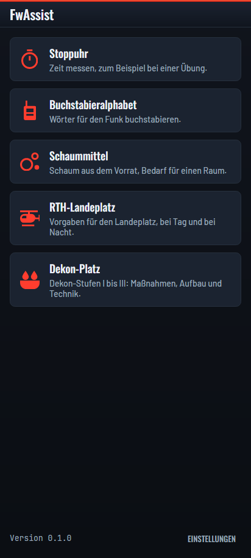
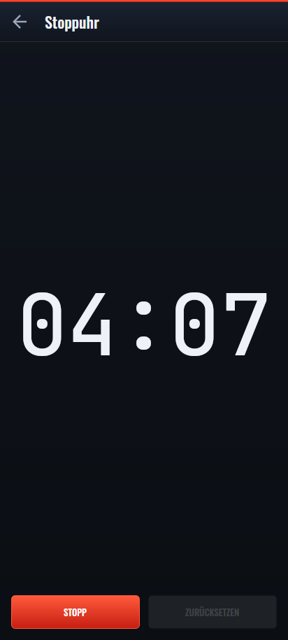
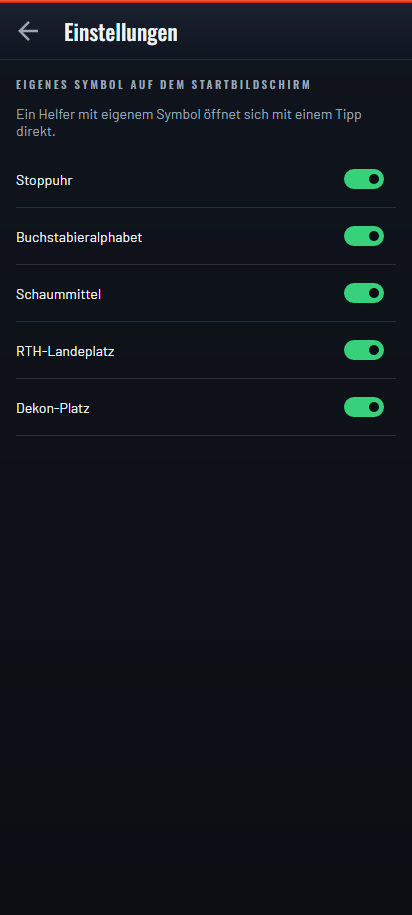
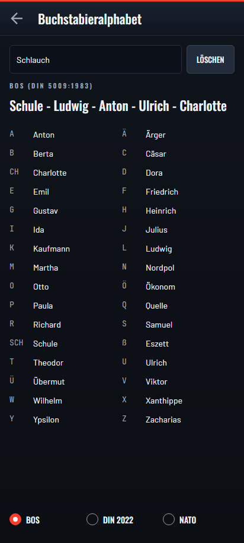
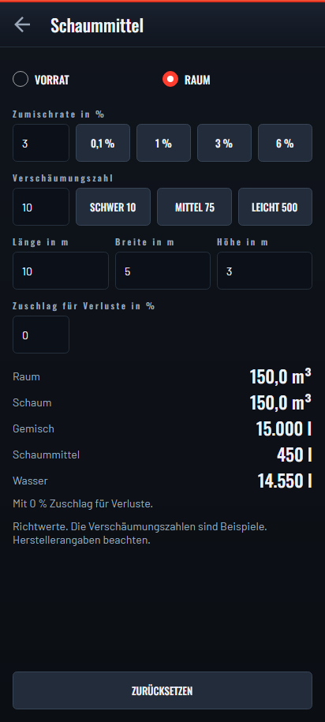
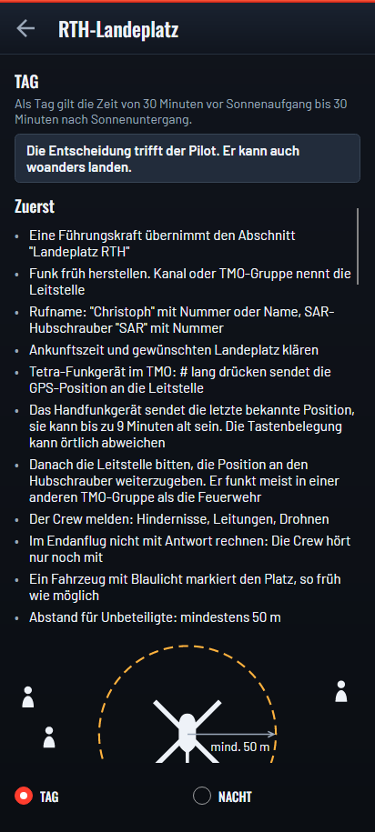
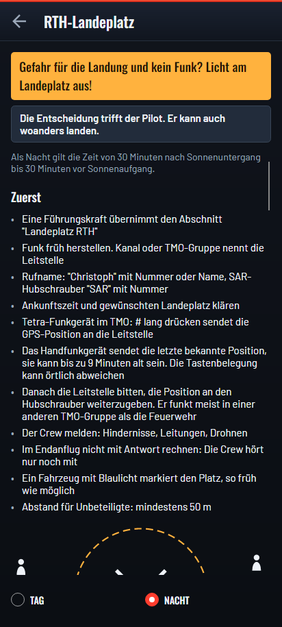
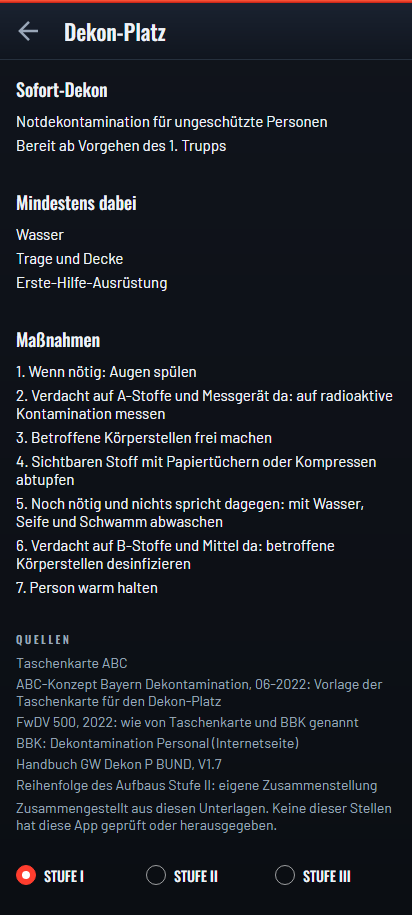
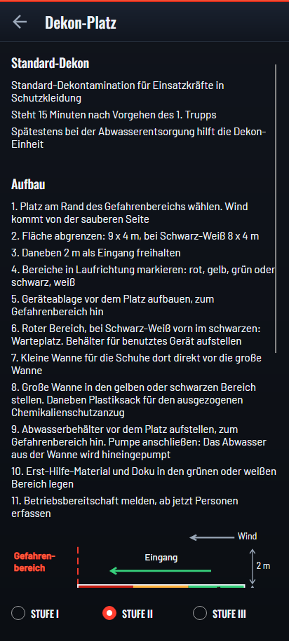
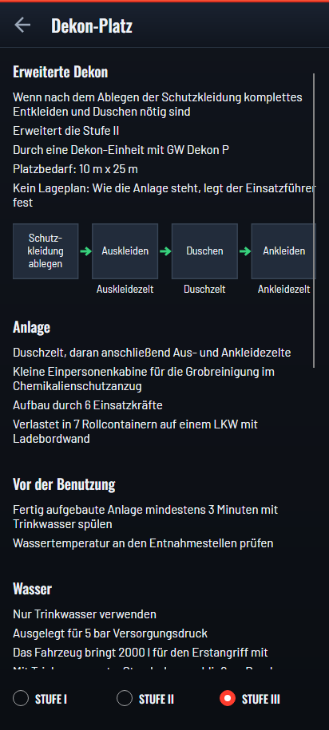

<p align="center">
  <strong>FwAssist — kleine Werkzeuge für die Feuerwehr.</strong><br />
  Für die Hosentasche. Offline. Open Source.
</p>

<p align="center">
  <a href="https://github.com/CodeForFire/helfer/actions/workflows/ci.yml"></a>
  <a href="../../releases"></a>
  <a href="LICENSE"></a>
</p>

FwAssist ist eine Android-App mit kleinen Werkzeugen für Feuerwehrangehörige.
Jedes Werkzeug – ein *Helfer* – macht genau eine Sache, funktioniert ohne Netz
und lässt sich mit einem eigenen Symbol direkt vom Startbildschirm öffnen.

FwAssist kommt von [CodeForFire](https://codeforfire.github.io/), von denselben
Leuten wie [Lagebuch](https://github.com/CodeForFire/lagebuch), und sieht
deshalb auch so aus.

*English speakers: the developer documentation starts at [For developers](#for-developers).*

## Die Helfer

| Helfer | Was er tut |
|---|---|
| **Stoppuhr** | Zeit messen, zum Beispiel bei einer Übung. Läuft weiter, während ein anderer Helfer offen ist. |
| **Buchstabieralphabet** | Wörter für den Funk buchstabieren, wahlweise mit der alten Tafel (Anton, Berta, …), nach DIN 5009:2022 (Aachen, Berlin, …) oder mit dem NATO-Alphabet (Alfa, Bravo, …). |
| **Schaummittel** | Rechnet in beide Richtungen: wie viel Schaum der Vorrat ergibt und wie viel Wasser und Schaummittel ein Raum braucht. |
| **RTH-Landeplatz** | Vorgaben und Ablauf, wenn die Feuerwehr einen Landeplatz für den Rettungshubschrauber vorbereitet, getrennt für Tag und Nacht. |
| **Dekon-Platz** | Dekon-Stufen I bis III: Sofortmaßnahmen, Aufbau und Plan für Stufe II, Technik und Ablauf für Stufe III. |

Weitere Helfer folgen. Welcher fehlt euch? Schreibt es unter
[Ideen](https://github.com/CodeForFire/helfer/discussions/categories/ideen).

## Ein Symbol pro Helfer

Nach der Installation hat jeder Helfer ein eigenes Symbol in der App-Übersicht
des Handys und öffnet sich damit direkt. Wer einen Helfer nicht braucht,
schaltet sein Symbol unter **Einstellungen** aus – der Helfer bleibt in der App
erreichbar.

## Datenschutz

Kein Konto, keine Anmeldung, keine Cloud, kein Server. Keine Telemetrie, keine
Werbung. Die App fordert keine Berechtigungen an und hat keinen Netzzugriff.

## Installation

Die APK für Android 7.0 und neuer liegt bei den
[Releases](../../releases). Beim ersten Mal muss für den Browser oder
Dateimanager *Installation aus unbekannten Quellen* erlaubt werden. Ein Eintrag
im Play Store ist in Vorbereitung.

### Downloads prüfen

Jedem Release liegt `SHA256SUMS.txt` bei, und die APK trägt einen
Sigstore-Herkunftsnachweis. Die Prüfsummen decken APK und SBOM ab; beide
gehören zum Prüfen in denselben Ordner wie `SHA256SUMS.txt`:

```
sha256sum -c SHA256SUMS.txt
gh attestation verify helfer-<version>.apk --repo CodeForFire/helfer
```

## Status

Frühe Entwicklung. Die App-Hülle steht, die Stoppuhr dient als Vorlage für alle
weiteren Helfer.

## Screenshots

| Übersicht | Stoppuhr | Einstellungen |
|---|---|---|
|  |  |  |

| Buchstabieralphabet | Schaummittel |
|---|---|
|  |  |

| RTH-Landeplatz bei Tag | RTH-Landeplatz bei Nacht |
|---|---|
|  |  |

| Dekon-Stufe I | Dekon-Stufe II | Dekon-Stufe III |
|---|---|---|
|  |  |  |

## Mitmachen & Kontakt

Fragen, Ideen und Berichte von der letzten Übung gerne unter
[Discussions](https://github.com/CodeForFire/helfer/discussions) – auf Deutsch
oder Englisch. Sicherheitslücken bitte vertraulich melden, siehe
[SECURITY.md](SECURITY.md).

## For developers

FwAssist is a single Android app hosting small, independent helper tools for
fire brigades: .NET 10 + Avalonia 12, the same stack, theme, workflows and
rules as [Lagebuch](https://github.com/CodeForFire/lagebuch), with a mobile-only
focus. The code and its documentation are in English, as are issues, pull
requests and commit messages; the UI is German. Conventions are in
[CONTRIBUTING.md](CONTRIBUTING.md) and, in full, in [AGENTS.md](AGENTS.md).

### Layout

```
src/Helfer.Core/            values and rules shared by every helper (no dependencies)
src/Helfer.AppLogic/        shell view models and service seams (no Avalonia)
src/Helfer.Ui/              Avalonia App, theme, shell views
src/Helpers/<Name>/         one helper: Helfer.Helpers.<Name> (logic) + .Ui (views)
src/Helfer.Composition/     the list of helpers, wired by hand
src/Helfer.App.Android/     thin Android head, one launcher alias per helper
```

Adding a helper is a checklist: see [AGENTS.md, "Helpers"](AGENTS.md#helpers).

### Build & Test

The SDK version is pinned in `global.json`. The Android head is built in Docker,
because `Microsoft.Android.Sdk` rejects any JDK newer than 21 (`XA0030`):

```bash
make ci                      # build + test + format check, everything but the Android head
make apk                     # the APK, in Docker
make apk ABI=android-x64     # one ABI only, for an emulator
make run-android             # boot the emulator, install and launch
make phone-screenshots       # render every screen to out/phone-screenshots
make screenshots             # regenerate docs/screenshots
make mutate PROJECT=Helpers.Stoppuhr SINCE=origin/main
```

Run `make` for the full list.

### Releasing

Pushing a version tag builds the APK and publishes it as a GitHub release; the
Google Play bundle is built locally with the upload key. See
[docs/releasing.md](docs/releasing.md).

## License

[MIT](LICENSE)
